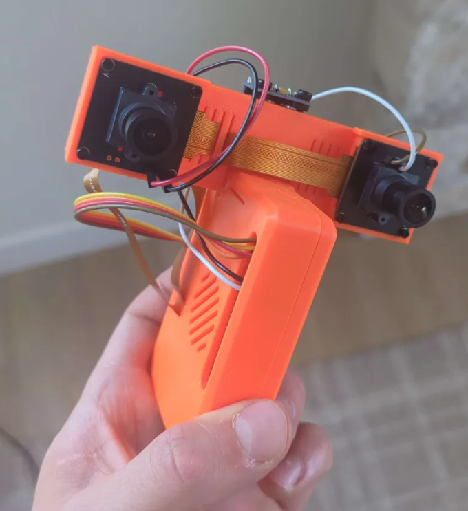
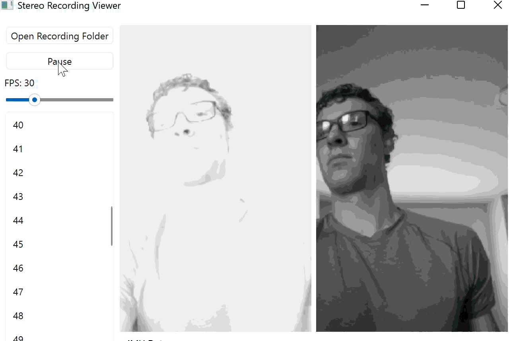
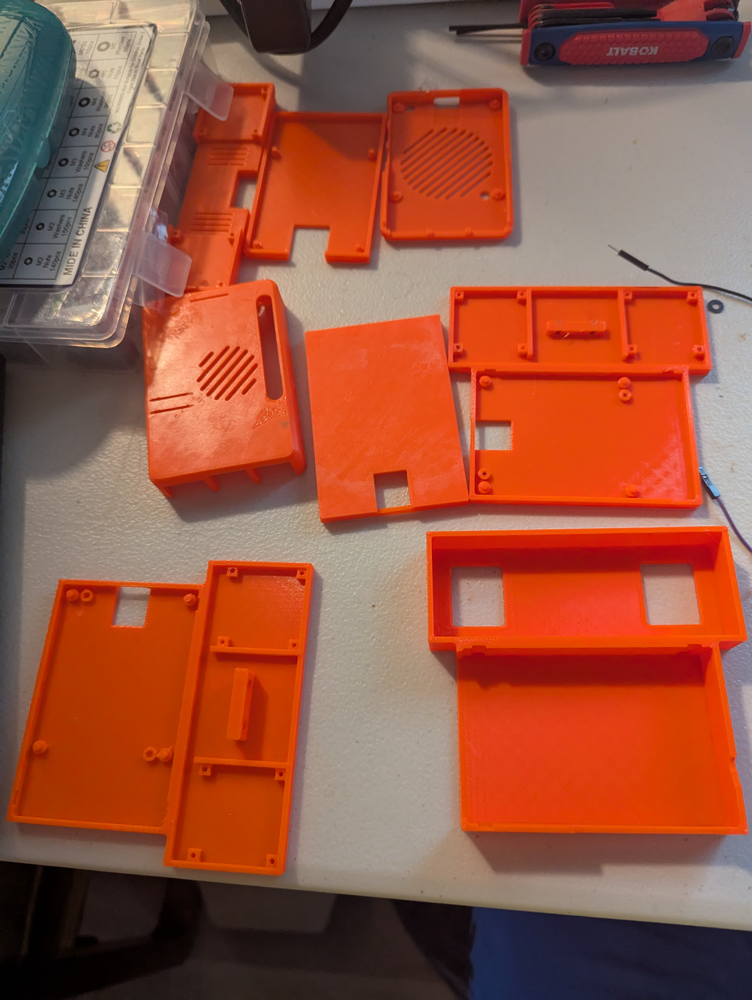
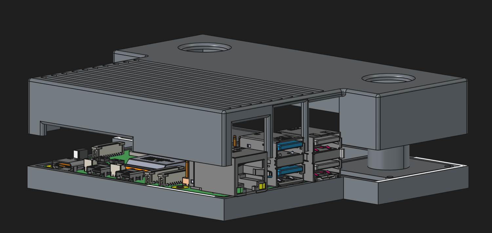
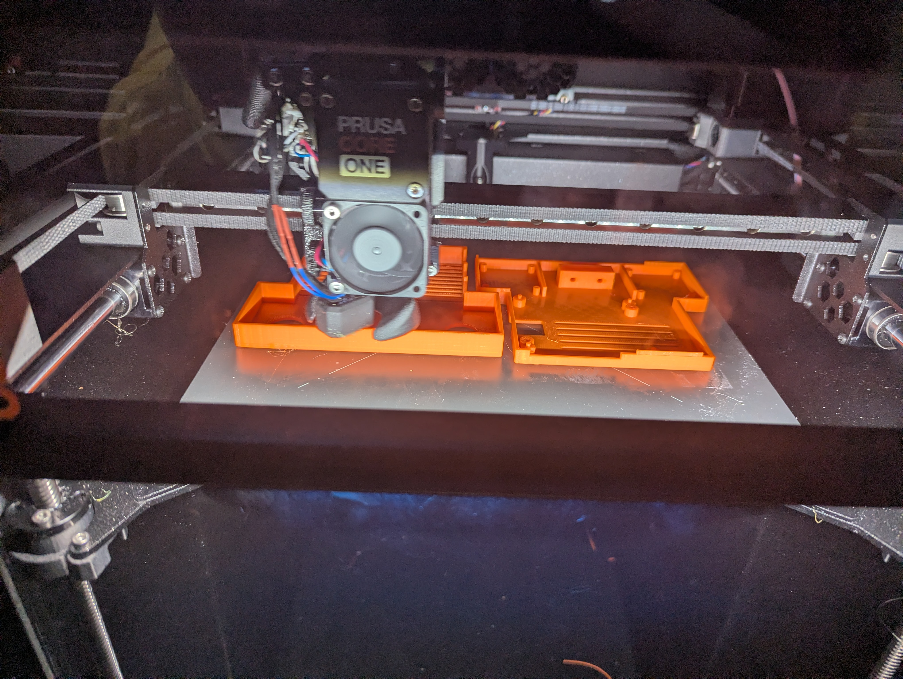
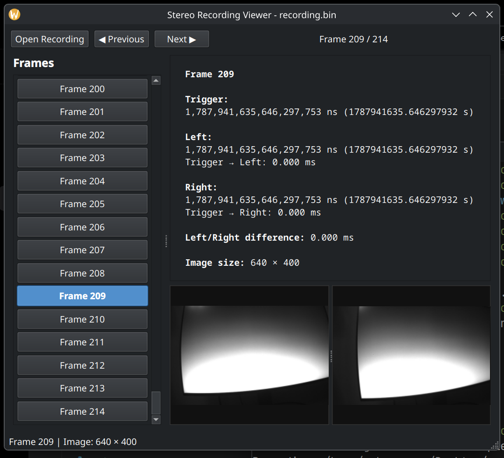
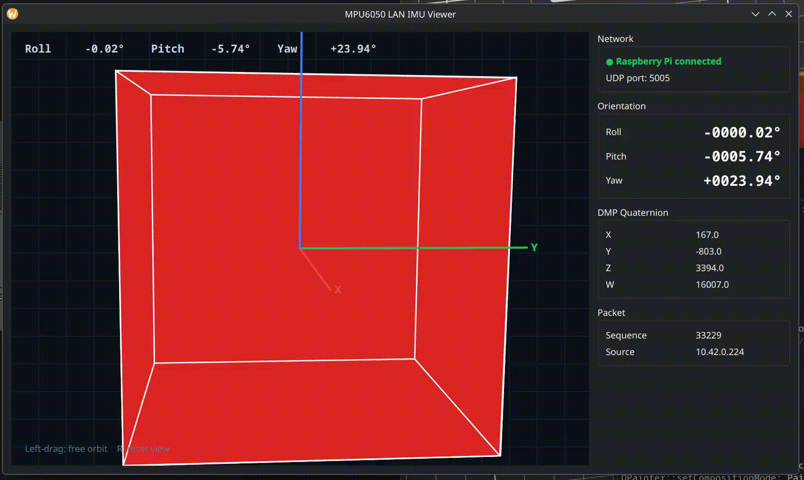

# Senior Project

## Goal

The goal of this project is to collect high-quality image data from a portable stereo vision device. The recorded data will later be used with a SLAM algorithm to determine the trajectory of the device.

The project is focused on building a complete prototype capable of collecting the sensor data needed for reliable trajectory estimation.

## Current Progress

- Prototype parts have been selected.
- The physical device and housing have been designed and refined through multiple iterations.
- The stereo camera setup has been assembled.
- Stereo image capture is working.
- The data collection software is still being refined.
- Current development is focused on collecting IMU data at the same time as the stereo images without losing capture speed.
- Once reliable data collection is complete, the collected data will be used with a SLAM algorithm to determine the trajectory of the device.

## Prototype

The device is built around a Raspberry Pi and a pair of stereo cameras.

The housing is custom designed to hold the cameras, Raspberry Pi, and other components in a compact package.

## Housing Development

The housing has gone through several design iterations as the physical layout and component placement have been refined.

The final housing is 3D printed and designed using CAD software.

The `CAD` folder contains the FreeCAD project files and 3MF models used to design and manufacture the housing.

## Data Collection

The `Capture` folder contains the software responsible for collecting stereo image and IMU data.

The stereo cameras are used to capture image data while the IMU provides motion information from the device. A major part of the current development is getting both data sources to operate at the same time without significantly reducing the image capture rate.

The folder also contains the camera triggering and `libcamera` configuration used by the stereo camera system.

The goal is to produce consistent, high-quality synchronized data that can later be passed into a SLAM algorithm.

## Viewer

The `Viewer` folder contains software for viewing and inspecting recorded data.

The viewer is used to inspect the captured stereo imagery and verify that the collected data is usable.

## Screen Flash

The `screenFlashBlackWhite` folder contains the software used to control the screen flashing component of the system.

The screen flash is part of the timing and synchronization system used during data collection.

## Project Structure

The repository is organized into the following main components:

- `CAD` contains the FreeCAD project files and 3MF models for the device housing.
- `Capture` contains the stereo camera, IMU, triggering, and data collection software.
- `Pictures` contains project photos, demonstrations, and other visual documentation.
- `Viewer` contains software for viewing and inspecting recorded data.
- `screenFlashBlackWhite` contains the screen flashing software used for synchronization.

## Project Status

The prototype hardware parts have been selected and the physical device is being refined.

The main software task currently underway is improving the data collection system so that IMU data can be collected concurrently with stereo images without sacrificing capture speed.

After the data collection system is sufficiently reliable, the next major stage of the project will be to run a SLAM algorithm on the collected data to estimate the trajectory of the device.

## Pictures
First Model

Superglued together, with cameras that required software rotation and were oriented vertically instead of horizontally.

Handheld demonstration of the old shell with the original viewing software. Capture rate was less than 30 Hz.

Case Development

Multiple case designs were tested before settling on the final clamshell design.

Final Clamshell Design

CAD design of the final device housing.

3D-printed version of the final housing.

Software

Current viewing tool.

Work in progress: rotation collection using the IMU6050.

